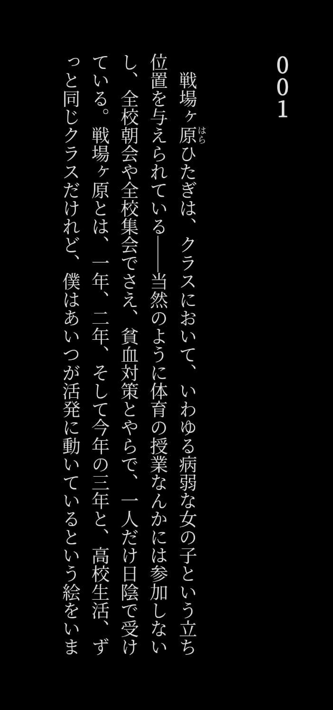
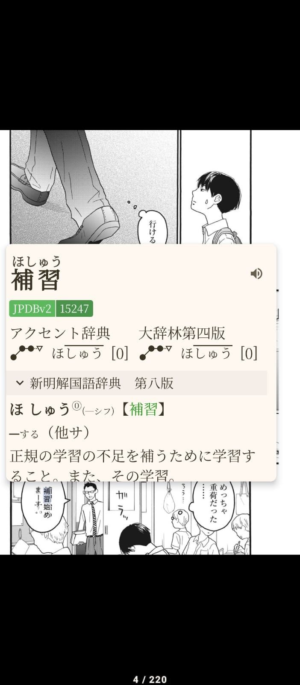
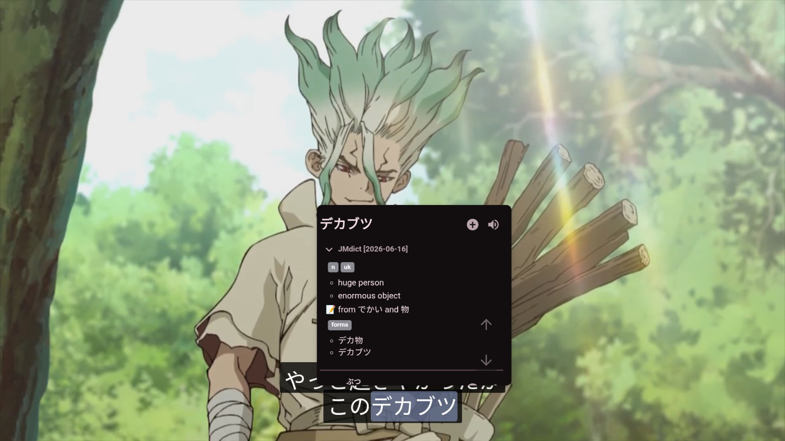
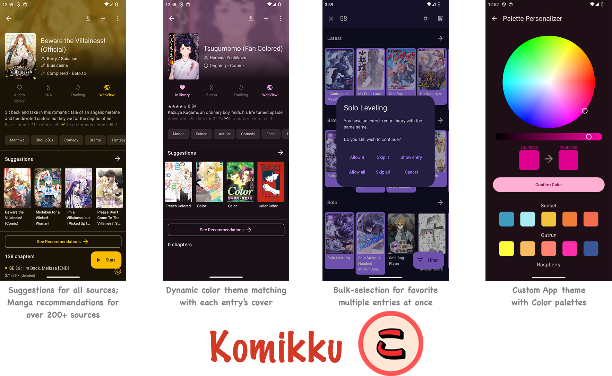

<h1 align="center">AniScroll</h1>

**An immersive manga, anime, and novel reader for Android.**

---

AniScroll is an open-source Android application built around the Mihon ecosystem, bringing manga, anime, and novel reading together in one place.

Inspired by the immersion-focused capabilities of Chimahon, AniScroll combines a powerful manga reading experience with extensive source support, anime integration, novel reading, and language-learning tools.

Whether you're discovering new manga, following your favourite anime, reading novels, or exploring language-learning workflows, AniScroll aims to provide a unified and customizable experience.

## 🖼️ Screenshots

  
  
  
  

## 🚀 Key Features

### 📖 Novel & Manga Support

- **Novel Reader**: Read EPUB and supported novel content through a dedicated reading interface, with access to reading tools and language-learning workflows.
- **Manga Reader**: A native manga reading experience with support for online sources, local content, and customizable reading configurations.
- **Panel-by-Panel Navigation**: Navigate manga using automatically detected comic panels, making it easier to follow individual panels instead of manually navigating entire pages.
- **Local OCR**: Recognize text directly from manga pages using on-device text recognition, allowing vocabulary lookup without relying on external OCR services.
- **.mokuro Support**: Read `.mokuro` formatted manga with pre-generated OCR information and text overlays, connecting manga reading with dictionary lookup and vocabulary mining.

### 🔍 Native Dictionary Lookup

- **Dictionary Management**: Import and manage dictionary files directly inside the application without requiring a separate dictionary application.
- **Multi-Language Dictionaries**: Work with dictionary data for Japanese, Chinese, Korean, and other supported languages.
- **Recursive Lookups**: Search words inside dictionary definitions to explore unfamiliar vocabulary without leaving the current lookup.
- **Dictionary Popup**: Access vocabulary information through an integrated lookup interface while reading supported content.
- **Customizable Appearance**: Configure dictionary presentation, fonts, and themes to suit your reading environment.
- **Pitch Accent**: Display Japanese pitch-accent information when supported by the imported dictionary data.

### 🎴 Anki Integration

- **Instant Card Mining**: Turn dictionary lookup results into vocabulary cards while reading, reducing the need to manually copy words into a separate flashcard application.
- **Screenshot Cropping**: Capture relevant portions of manga pages and attach them to vocabulary cards for visual context.
- **Flexible Field Mapping**: Configure how vocabulary information such as expressions, readings, definitions, pitch accent, and context sentences are transferred into Anki.
- **Duplicate Detection**: Check existing cards to help avoid creating duplicate vocabulary entries.

### 🌐 Screen OCR Lookup

- **System-Wide Text Recognition**: Capture text displayed in other applications and use OCR to identify words for dictionary lookup.
- **Interactive Word Selection**: Select recognized words from captured screen content to access their definitions.
- **Vocabulary Mining**: Use captured text as a starting point for collecting vocabulary outside the application's own readers.

### 🎬 Anime & Video Player

- **Integrated Video Player**: Watch supported video content through the built-in MPV-based playback experience.
- **Subtitle Dictionary Lookup**: Look up vocabulary directly from supported subtitles without manually switching between applications.
- **Jimaku Integration**: Search for, retrieve, and synchronize Japanese subtitles through the supported subtitle integration.
- **Video Frame OCR**: Recognize text visible inside video frames, including signs and on-screen text that may not be included in subtitle files.
- **YouTube Integration**: Access supported YouTube content through the integrated extension.
- **Anime Library**: Browse, organize, and track anime through supported sources and integrations.

---

## 🔒 Security & Reliability

AniScroll treats source configuration, backups, and external media as untrusted input.

- **Encrypted Backups**: Optionally protect backups with a password using AES-256-GCM and PBKDF2 key derivation. Legacy unencrypted backups remain supported. Lost passwords cannot be recovered.
- **Plugin Integrity Checks**: Novel source plugins are verified against repository-provided SHA-256 checksums before execution; unverified remote JavaScript is refused.
- **Hardened WebViews**: Reader and dictionary WebViews disable universal file-origin access, restrict active mixed content, and enable Safe Browsing.
- **Strict Network Trust**: Release builds trust only system certificate authorities. Debug builds may additionally trust user-installed CAs for local proxies.
- **Validated External Media**: The exported video player accepts only supported URI schemes and readable content, and restricts YouTube intents to trusted hosts.
- **Download Integrity**: Resumed downloads validate server range offsets and final file sizes before being treated as complete.

---

## 🛠️ Core Features (Inherited from Upstream)

AniScroll builds upon the established Mihon and Komikku ecosystem, retaining the core features that make these projects powerful manga management and reading applications.

  

- **Extensive Source Support**: Browse and read manga from community-maintained sources through compatible extensions.
- **Extension Repositories**: Add and manage repositories to discover and install supported content sources.
- **Library Management**: Organize your manga collection, manage categories, and keep track of your reading activity.
- **Reading History**: Quickly access previously opened manga and chapters.
- **Download Management**: Download chapters for offline reading and manage downloaded content.
- **Related Suggestions**: Discover related titles and recommendations where supported by the source.
- **Dynamic Theming**: Customize the interface with themes and colors that can adapt to manga cover artwork.
- **External Tracking**: Connect supported tracking services to synchronize reading progress.
- **Backup & Restore**: Protect your library and reading progress through local or supported cloud backups, including optional password encryption.
- **Reader Customization**: Configure reading direction, navigation, display behaviour, and other reader preferences.

---

## 📥 Download

Download the latest available AniScroll release from GitHub.

For installation, download the APK compatible with your device and install it using Android's package installer.

---

## 🤝 Contributing & Support

- **Bugs & Feature Requests**: Report problems or suggest improvements through [GitHub Issues](https://github.com/aryannayak-real/AniScroll/issues).
- **Contributing**: Contributions are welcome! See [CONTRIBUTING.md](./CONTRIBUTING.md) for project guidelines.
- **Discussions**: Help improve AniScroll by sharing feedback, reporting issues, and contributing ideas.

### Credits & Acknowledgments

AniScroll builds upon the work of many open-source developers and projects.

- [Mihon](https://github.com/mihonapp/mihon): The foundation for the manga reading experience and core application architecture.
- [Chimahon](https://github.com/sohilsayed/chimahon): Upstream immersion-focused project and its additional functionality.
- [Komikku](https://github.com/komikku-app/komikku): Upstream manga application contributions.
- [Yomitan](https://github.com/yomidevs/yomitan): Inspiration for dictionary and language-learning workflows.
- [Hoshidicts](https://github.com/Chimahon/hoshidicts): Dictionary engine used by the upstream immersion implementation.
- All upstream developers, extension authors, translators, and contributors whose work helps make AniScroll possible.

### License

AniScroll retains the licensing obligations of its upstream projects.

This project is distributed under the applicable GNU General Public License. See [LICENSE](./LICENSE) and [NOTICE](./NOTICE) for complete details and attribution.

---

**Made with ❤️ for manga, anime, and language-learning enthusiasts.**

