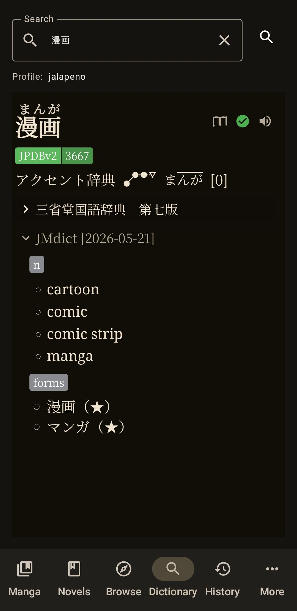

<div align="center">


<h1 align="center">AniScroll</h1>

**An immersive manga, anime, and novel reader for Android.**

[](https://github.com/aryannayak-real/AniScroll/releases/latest)
[](https://github.com/aryannayak-real/AniScroll/releases)
[](https://github.com/aryannayak-real/AniScroll/stargazers)
[](https://aryannayak-real.github.io/aniscroll-website/)
[](https://discord.gg/qRVrH2BW3V)
[](./LICENSE)

[Website](https://aryannayak-real.github.io/aniscroll-website/) · [Download](https://github.com/aryannayak-real/AniScroll/releases/latest) · [Releases](https://github.com/aryannayak-real/AniScroll/releases) · [Issues](https://github.com/aryannayak-real/AniScroll/issues) · [Discord](https://discord.gg/qRVrH2BW3V) · [Changelog](./CHANGELOG.md)

</div>

---

AniScroll is an open-source Android application built around the Mihon ecosystem, bringing manga, anime, and novel reading together in one place.

🌐 **Official website:** [aryannayak-real.github.io/aniscroll-website](https://aryannayak-real.github.io/aniscroll-website/) — screenshots, download links, feature notes, privacy details, and FAQ.

Inspired by the immersion-focused capabilities of Chimahon, AniScroll combines a powerful manga reading experience with extensive source support, anime integration, novel reading, and language-learning tools.

Whether you are discovering new manga, following your favourite anime, reading novels, or exploring language-learning workflows, AniScroll aims to provide a unified and customizable experience without forcing you into a separate dictionary, OCR, or flashcard app.

## 📌 At a Glance

| | |
| --- | --- |
| **Platform** | Android 8.0+ (API 26) |
| **Application ID** | `app.chimahon` |
| **Built with** | Kotlin, Jetpack Compose, AndroidX, Kotlin Coroutines/Flow |
| **Content** | Manga, anime, and novels |
| **Language tools** | Dictionary lookup, OCR, pitch accent, recursive lookup, Anki mining |
| **Dictionary sources** | Imported offline ZIP dictionaries plus optional online fallback |
| **Video playback** | MPV-based player with subtitle lookup and frame OCR |
| **License** | GNU General Public License |
| **Website** | [aryannayak-real.github.io/aniscroll-website](https://aryannayak-real.github.io/aniscroll-website/) |

## ✨ Highlights

- **One library for different media** — keep manga, anime, and novels close together instead of switching between unrelated apps.
- **Dictionary-first reading** — look up words from manga panels, novel text, subtitles, video frames, and other apps.
- **Online fallback without setup** — start looking up words immediately. Japanese uses Jisho/JMdict; Chinese, Korean, and other languages use Wiktionary.
- **Offline control when you want it** — import compatible ZIP dictionaries for local definitions, pitch accent, frequency data, and consistent Anki fields.
- **Mining built into the reading flow** — capture context, crop screenshots, map Anki fields, and check for duplicates.
- **Local-first and open source** — your library stays on your device, no account is required, and the source code is public.

## 🖼️ Screenshots

<p align="center">
  
  
  
  
</p>

<p align="center">
  <sub>Novel reader · Manga dictionary popup · Dictionary tab · Anime player with subtitle lookup</sub>
</p>

## 🚀 Key Features

### 📖 Manga & Novel Reading

- **Manga Reader**: A native reading experience with online sources, local content, configurable reading modes, and library management.
- **Panel-by-Panel Navigation**: Automatically detected comic panels make it easier to follow individual panels instead of manually moving across entire pages.
- **Novel Reader**: Read EPUB and supported novel content through a dedicated interface with access to reading and language-learning tools.
- **Local OCR**: Recognise text directly from manga pages using on-device text recognition, allowing vocabulary lookup without sending page images to an external OCR service.
- **.mokuro Support**: Read `.mokuro` content with pre-generated OCR data and text overlays, connecting manga reading with dictionary lookup and vocabulary mining.
- **Reader Customisation**: Configure reading direction, navigation, display behaviour, and other reader preferences.

### 🔍 Native Dictionary Lookup

- **Dictionary Management**: Import and manage compatible dictionary files directly inside the app without needing a separate dictionary application.
- **Online Fallback**: Search before importing anything. Japanese lookups use Jisho/JMdict; Chinese, Korean, and other languages use Wiktionary.
- **Multi-Language Support**: Work with dictionary data for Japanese, Chinese, Korean, and other supported languages.
- **Local-First Lookup Order**: Imported dictionaries are used first. The online fallback is there for when local data is unavailable.
- **Recursive Lookups**: Select words inside definitions to explore unfamiliar vocabulary without leaving the current lookup.
- **Dictionary Popup**: Access vocabulary information through an integrated lookup interface while reading supported content.
- **Pitch Accent**: Display Japanese pitch-accent information when supplied by imported dictionary data.
- **Frequency Data**: Use frequency information from compatible imported dictionaries to help prioritise vocabulary.
- **Customisable Appearance**: Adjust dictionary presentation, fonts, and themes to match your reading environment.

### 🎴 Anki & Vocabulary Mining

- **Instant Card Mining**: Turn a lookup into a vocabulary card while reading, without copying information into a separate flashcard app by hand.
- **Screenshot Cropping**: Capture the relevant part of a manga page, video frame, or reading view for visual context.
- **Flexible Field Mapping**: Configure how expressions, readings, definitions, pitch accent, and context sentences are transferred into Anki.
- **Duplicate Detection**: Check existing cards to avoid creating repeated vocabulary entries.
- **Context Preservation**: Keep the source sentence or panel around the target word so the card is useful when you review it later.

### 🌐 Screen & Video OCR

- **System-Wide Text Recognition**: Capture text displayed in other applications and use OCR to identify words for dictionary lookup.
- **Interactive Word Selection**: Choose recognised words from captured screen content and open their definitions.
- **Video Frame OCR**: Recognise text visible inside video frames, including signs and on-screen text that may not exist in subtitle files.
- **Vocabulary Mining Anywhere**: Use captured text as a starting point for collecting vocabulary outside AniScroll's own readers.

### 🎬 Anime & Video

- **Integrated Video Player**: Watch supported video content through the built-in MPV-based playback experience.
- **Subtitle Dictionary Lookup**: Look up vocabulary directly from supported subtitles without switching apps.
- **Jimaku Integration**: Search for, retrieve, and synchronise Japanese subtitles through the supported subtitle integration.
- **Anime Library**: Browse, organise, and track anime through supported sources and integrations.
- **YouTube Integration**: Access supported YouTube content through the integrated extension.

### 📚 Library & Source Management

- **Extensive Source Support**: Browse and read manga from community-maintained sources through compatible extensions.
- **Extension Repositories**: Add and manage repositories to discover and install supported content sources.
- **Library Management**: Organise your collection, manage categories, and keep track of reading activity.
- **Reading History**: Quickly return to previously opened manga and chapters.
- **Download Management**: Download chapters for offline reading and manage downloaded content.
- **Related Suggestions**: Discover related titles and recommendations where supported by the source.
- **Dynamic Theming**: Customise the interface with themes and colours that can adapt to manga cover artwork.
- **External Tracking**: Connect supported tracking services to synchronise reading progress.
- **Backup & Restore**: Protect your library and reading progress through local or supported cloud backups, including optional password encryption.

## 🔍 How Dictionary Lookup Works

AniScroll uses a layered lookup model:

1. **Imported dictionaries first** — if a local term, frequency, or pitch dictionary contains the word, that data is used.
2. **Online fallback when needed** — if local data is unavailable and online lookup is enabled, AniScroll queries the appropriate provider.
3. **Japanese** — Jisho and JMdict data.
4. **Chinese, Korean, and other languages** — Wiktionary.
5. **Results stay useful** — entries can be used for recursive lookup, reading context, and Anki card creation.

Online fallback is enabled by default and can be disabled at any time in **Settings → Dictionary**.

### Online fallback privacy

When online fallback is enabled, only the searched term is sent to the selected dictionary provider. No account, library, reading history, or device identifier is included in the dictionary request.

If you want fully offline lookups, disable the online fallback. Imported ZIP dictionaries continue to work without a network connection.

### Online vs. offline data

Online lookup is designed to be a convenient fallback, not a replacement for a complete study dictionary. Online-only entries may have less detail than imported dictionaries, especially for readings, romanisation, pitch accent, and frequency information.

For a more consistent language-learning workflow, import a compatible dictionary. This is especially useful if you want:

- fuller readings and definitions
- Japanese pitch accent
- frequency information
- more predictable Anki field population
- dictionary lookups with no network requests

## 🎴 Typical Anki Workflow

1. **Find a word** while reading manga, watching anime, reading a novel, or using screen OCR.
2. **Review the entry** and confirm the expression, reading, definition, and context.
3. **Capture context** by selecting or cropping the relevant panel or frame.
4. **Map the fields** according to your Anki note type.
5. **Create the card** after the duplicate check.

Anki connection details and field mapping are configurable in the app settings.

## 📥 Download & Installation

Download the latest stable release from GitHub:

[](https://github.com/aryannayak-real/AniScroll/releases/latest)

The release includes a universal APK and smaller per-ABI APKs.

| APK | Recommended for |
| --- | --- |
| `AniScroll-<version>.apk` | Most users. Universal build that works on supported devices. |
| `AniScroll-arm64-v8a-<version>.apk` | Modern 64-bit ARM phones and tablets. |
| `AniScroll-armeabi-v7a-<version>.apk` | Older 32-bit ARM devices. |
| `AniScroll-x86_64-<version>.apk` | Many emulators and Intel/AMD 64-bit devices. |
| `AniScroll-x86-<version>.apk` | Older 32-bit x86 emulators and devices. |

### Installation steps

1. Download the APK that matches your device, or use the universal APK if you are unsure.
2. Open the downloaded APK.
3. If Android asks, allow installs from your browser or file manager for this one installation.
4. Install and open AniScroll.
5. Optionally add compatible extension repositories, import a dictionary, and configure Anki.

### Requirements

- Android 8.0 or newer (API 26+)
- Network access for online sources and the online dictionary fallback
- Additional storage for downloads, dictionaries, and backups

### Updating

Install the newer APK over your existing AniScroll installation. Your library, settings, and reading progress are preserved across normal updates.

Back up your library before switching between significantly different builds or making major changes.

## 🔐 Privacy & Network Use

AniScroll is designed to keep your reading library on your device.

- **No account required** — there is no sign-up, profile, or mandatory cloud account.
- **Local library** — manga, anime, novels, reading progress, settings, and downloads are stored locally.
- **Online dictionary lookups** — when enabled, the searched word is sent to Jisho/JMdict or Wiktionary. The fallback can be disabled.
- **Sources and extensions** — content sources, extension repositories, video hosts, and other services operate independently and have their own privacy policies.
- **Optional backups** — backups are created only when requested and can be protected with a password.
- **Website** — the official website is a static site and does not use advertising or third-party analytics.

Read the full privacy policy on the website: [Privacy Policy](https://aryannayak-real.github.io/aniscroll-website/privacy/).

## 🔒 Security & Reliability

AniScroll treats source configuration, backups, and external media as untrusted input.

- **Encrypted Backups**: Optionally protect backups with a password using AES-256-GCM and PBKDF2 key derivation. Legacy unencrypted backups remain supported. Lost passwords cannot be recovered.
- **Plugin Integrity Checks**: Novel source plugins are verified against repository-provided SHA-256 checksums before execution; unverified remote JavaScript is refused.
- **Hardened WebViews**: Reader and dictionary WebViews disable universal file-origin access, restrict active mixed content, and enable Safe Browsing.
- **Strict Network Trust**: Release builds trust only system certificate authorities. Debug builds may additionally trust user-installed CAs for local proxies.
- **Validated External Media**: The exported video player accepts only supported URI schemes and readable content, and restricts YouTube intents to trusted hosts.
- **Download Integrity**: Resumed downloads validate server range offsets and final file sizes before being treated as complete.

## 🛠️ Core Features Inherited from Upstream

AniScroll builds upon the established Mihon and Komikku ecosystem, retaining the core features that make these projects powerful manga management and reading applications.

<p align="center">
  
</p>

- **Extensive Source Support**: Browse and read manga from community-maintained sources through compatible extensions.
- **Extension Repositories**: Add and manage repositories to discover and install supported content sources.
- **Library Management**: Organise your manga collection, manage categories, and keep track of reading activity.
- **Reading History**: Quickly access previously opened manga and chapters.
- **Download Management**: Download chapters for offline reading and manage downloaded content.
- **Related Suggestions**: Discover related titles and recommendations where supported by the source.
- **Dynamic Theming**: Customise the interface with themes and colours that can adapt to manga cover artwork.
- **External Tracking**: Connect supported tracking services to synchronise reading progress.
- **Backup & Restore**: Protect your library and reading progress through local or supported cloud backups, including optional password encryption.
- **Reader Customisation**: Configure reading direction, navigation, display behaviour, and other reader preferences.

## 🧱 Build from Source

### Prerequisites

- JDK 17
- Android SDK Platform 36
- Android Studio or Android command-line tools
- Git

The Gradle wrapper is included in the repository. You do not need to install Gradle separately.

### Clone and build

```bash
git clone https://github.com/aryannayak-real/AniScroll.git
cd AniScroll

# Build a debug APK
./gradlew assembleDebug
```

The debug APK is written under `app/build/outputs/apk/debug/`.

### Run unit tests

```bash
./gradlew testDebugUnitTest
```

### Production build

The release workflow builds signed APKs for all supported ABIs:

```bash
./gradlew assembleRelease -Penable-updater
```

Production signing in CI uses repository secrets. A local release build requires your own signing configuration if you want an installable signed APK.

### Android Studio

You can also open the project in Android Studio, select the `app` run configuration, and run it on a device or emulator with Android 8.0 or newer.

If the SDK is not detected, set `ANDROID_HOME` or create a local `local.properties` file pointing to your Android SDK.

## 🗂️ Project Structure

| Path | Responsibility |
| --- | --- |
| `app/` | Android UI, readers, settings, video player, and Anki integration |
| `chimahon/` | Dictionary repository, online fallback, language tooling, and immersion features |
| `chimahon-local-ocr/` | On-device OCR components |
| `core/` | Shared foundational modules |
| `data/` | Persistence, repositories, and data-layer implementations |
| `domain/` | Domain models and use cases |
| `source-api/` | Source and extension interfaces |
| `source-local/` | Local source implementation |
| `i18n*/` | Localisation resources |
| `buildSrc/` | Build logic and shared Android configuration |
| `.github/workflows/` | Continuous integration and release automation |

## ❓ FAQ

**Is AniScroll free?**  
Yes. AniScroll is free and open source. There are no ads and no account is required.

**Do I need to import a dictionary?**  
No. Online lookup works out of the box. Import a compatible ZIP dictionary if you want offline definitions, pitch accent, frequency data, or more consistent Anki fields.

**Which dictionary languages work online?**  
Japanese lookups use Jisho/JMdict. Chinese, Korean, and other languages use Wiktionary. Offline support depends on the dictionaries you import.

**Does AniScroll work offline?**  
Yes for local content, downloaded chapters, and imported dictionaries. Online sources, online dictionary lookups, and some anime features require network access.

**Is my reading data private?**  
Your library stays on your device. Online dictionary lookups send only the searched term to the selected provider and can be disabled. Backups can be encrypted.

**How do I update?**  
Download the latest APK and install it over your current version. Normal updates preserve your library and settings.

**Why does an online-only entry lack readings or pitch accent?**  
Online lookup is a fallback designed for quick definitions. Import a compatible offline dictionary for richer readings, pitch accent, frequency data, and Anki fields.

**Does AniScroll include content sources?**  
No. AniScroll is a client. Content sources and extensions are provided separately. Use compatible repositories and only access content you have the right to use.

**Is there an iOS version?**  
No. AniScroll is built for Android.

## 🤝 Contributing & Support

- **Bugs & Feature Requests**: Report problems or suggest improvements through [GitHub Issues](https://github.com/aryannayak-real/AniScroll/issues).
- **Pull Requests**: Contributions are welcome. For large changes, open an issue first so the approach can be discussed.
- **Testing**: Run `./gradlew testDebugUnitTest` before submitting code changes.
- **Keep Changes Focused**: Avoid unrelated refactors in the same pull request.
- **Community**: Join the [Discord](https://discord.gg/qRVrH2BW3V) for discussion and support.

Please do not include copyrighted media, private credentials, or personal data in issues and pull requests.

### Credits & Acknowledgments

AniScroll builds upon the work of many open-source developers and projects.

- [Mihon](https://github.com/mihonapp/mihon): The foundation for the manga reading experience and core application architecture.
- [Chimahon](https://github.com/sohilsayed/chimahon): Upstream immersion-focused project and its additional functionality.
- [Komikku](https://github.com/komikku-app/komikku): Upstream manga application contributions.
- [Yomitan](https://github.com/yomidevs/yomitan): Inspiration for dictionary and language-learning workflows.
- [Hoshidicts](https://github.com/Chimahon/hoshidicts): Dictionary engine used by the upstream immersion implementation.
- All upstream developers, extension authors, translators, and contributors whose work helps make AniScroll possible.

### License

AniScroll retains the licensing obligations of its upstream projects.

This project is distributed under the applicable GNU General Public License. See [LICENSE](./LICENSE) and [NOTICE](./NOTICE) for complete details and attribution.

## ⚠️ Disclaimer

AniScroll does not host, bundle, or distribute manga, anime, novels, or other media. Content comes from sources, extensions, and services that you choose to use. You are responsible for complying with local laws and the terms of those services.

AniScroll is an independent project and is not affiliated with the upstream projects it builds upon.

---

<div align="center">

**Made with ❤️ for manga, anime, and language-learning enthusiasts.**

<a href="https://github.com/aryannayak-real/AniScroll/graphs/contributors">
  
</a>

<br />
<br />

[Website](https://aryannayak-real.github.io/aniscroll-website/) · [Download](https://github.com/aryannayak-real/AniScroll/releases/latest) · [Issues](https://github.com/aryannayak-real/AniScroll/issues) · [Discord](https://discord.gg/qRVrH2BW3V)

</div>
